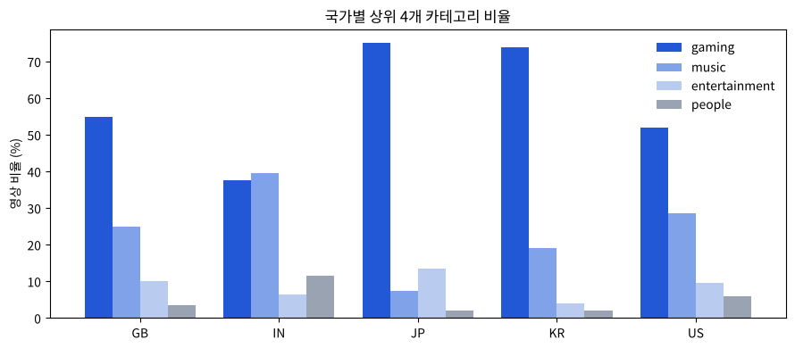
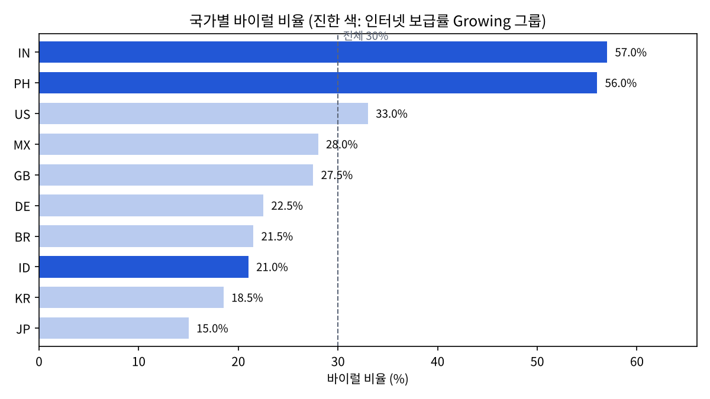
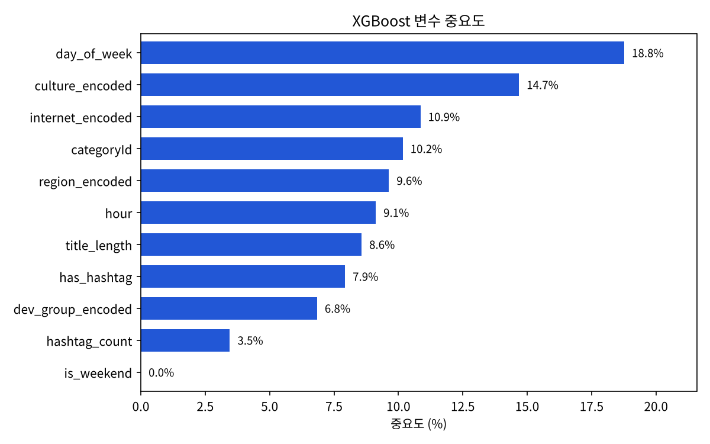

# Predicting YouTube Viral Potential from Pre-upload Metadata

업로드 전에 정할 수 있는 정보(카테고리, 제목 길이, 업로드 시각, 국가)만으로 YouTube 영상의 바이럴 가능성을 예측한 프로젝트

| 항목 | 내용 |
|---|---|
| 기간 | 2025.10 ~ 2025.11 |
| 구성 | 6인 팀 (명지대학교 경영정보학과) |
| 내 역할 | YouTube Data API 데이터 수집, 탐색적 분석(EDA), 바이럴 예측 모델링 |
| 사용 기술 | Python, pandas, YouTube Data API v3, scikit-learn, XGBoost, Jupyter |

## 1. 문제 정의

- 매일 수많은 영상이 올라오는 환경에서 인기 급상승 진입은 영상 품질만으로 결정되지 않음
- 기존 연구는 단일 국가나 특정 카테고리에 한정
- 크리에이터가 **업로드 전에 직접 조정할 수 있는 변수**만으로 바이럴 여부를 미리 판단하는 모델 목표

## 2. 데이터

- YouTube Data API v3 `videos.list (chart=mostPopular)`로 10개국 인기 급상승 영상 국가별 200개, 총 2,000개
  - US, GB, DE, KR, JP, IN, BR, MX, ID, PH
  - 업로드일 범위 2025.10.23 ~ 11.18
- 타깃: 조회수 상위 30%(180,268회 이상)를 바이럴(1), 나머지를 일반(0)으로 정의
- 국가 그룹 변수 3종: 선진국/개도국, 문화권, 인터넷 보급률(DataReportal·ITU 2024)

## 3. 분석 과정

### 3-1. 탐색적 분석 (5개국 1,000개) → [01_eda_5countries.ipynb](notebooks/01_eda_5countries.ipynb)

모델링 전에 한국·미국·영국·일본·인도 데이터로 국가·카테고리·태그·업로드 시점 차이 확인



- 일본·한국은 게임 영상 비율 70% 이상, 인도는 음악 비율이 가장 높음 → 국가 변수 필요

### 3-2. 바이럴 예측 모델링 (10개국 2,000개) → [02_modeling.ipynb](notebooks/02_modeling.ipynb)

- 변수 11개: 카테고리, 국가·국가 그룹 3종, 태그 유무·개수, 업로드 시간·요일·주말 여부, 제목 길이
- Logistic Regression, Random Forest, XGBoost 비교
- 8:2 Stratified Split, 클래스 불균형(30:70)은 클래스 가중치로 보정 (XGBoost `scale_pos_weight` ≈ 2.33)
- 5-Fold Stratified Cross-Validation으로 일반화 성능 확인

## 4. 결과

| 모델 | 테스트 정확도 | 바이럴 Recall |
|---|---|---|
| 기준선 (전부 일반으로 예측) | 70.0% | 0% |
| Logistic Regression | 64.2% | 58.3% |
| Random Forest | 77.0% | 64.2% |
| **XGBoost** | **80.0%** | **70.0%** |

- XGBoost 5-Fold 교차검증 평균 정확도 77.3%
- 인터넷 보급률이 낮은 Growing 그룹(인도·필리핀·인도네시아)의 바이럴 비율 44.7%로 High 그룹(23.3%)의 약 2배





## 5. 결과 검증과 한계

모델 결과를 그대로 받아들이지 않고 추가로 확인한 내용

| 확인 내용 | 결과 | 의미 |
|---|---|---|
| 변수 중요도 1위인 **업로드 요일** | 영상의 64%가 수집 직전 하루(11.17)에 업로드됨. 업로드 12시간 이내 영상의 바이럴 비율 20%, 2~4일 지난 영상은 50% | 요일 효과 중 상당 부분이 '조회수가 쌓일 시간' 차이일 가능성 |
| 태그 변수 | `hashtag_count`는 97.6%가 0 (태그에 `#` 기호가 거의 없음) | 태그 개수는 쉼표 기준으로 다시 세야 함 |
| 처음 보는 국가 예측 (국가 단위 교차검증) | 평균 정확도 66.6% | 국가 특성에 크게 의존해 새로운 시장 예측에는 한계 |

**개선 방향**: 여러 날에 걸친 반복 수집, 업로드 후 경과 시간 통제, 국가별 바이럴 기준 분리, 썸네일 등 이미지 정보 추가

## 6. 실행 방법

```bash
pip install requests pandas python-dotenv tqdm openpyxl scikit-learn xgboost matplotlib
cp .env.example .env   # .env에 본인 YouTube API 키 입력
python collect_trending.py
```

> 수집 데이터는 YouTube API 약관을 고려해 저장소에 포함하지 않음. 노트북에 실행 결과가 저장되어 있어 코드를 실행하지 않아도 결과 확인 가능

## 폴더 구조

```
├── collect_trending.py              # 데이터 수집
├── notebooks/
│   ├── 01_eda_5countries.ipynb      # 탐색적 분석
│   └── 02_modeling.ipynb            # 바이럴 예측 모델링과 검증
├── images/                          # README 그래프
├── .env.example                     # API 키 입력 예시
└── README.md
```
